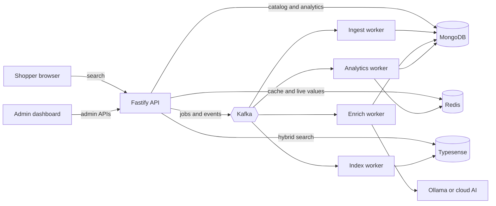
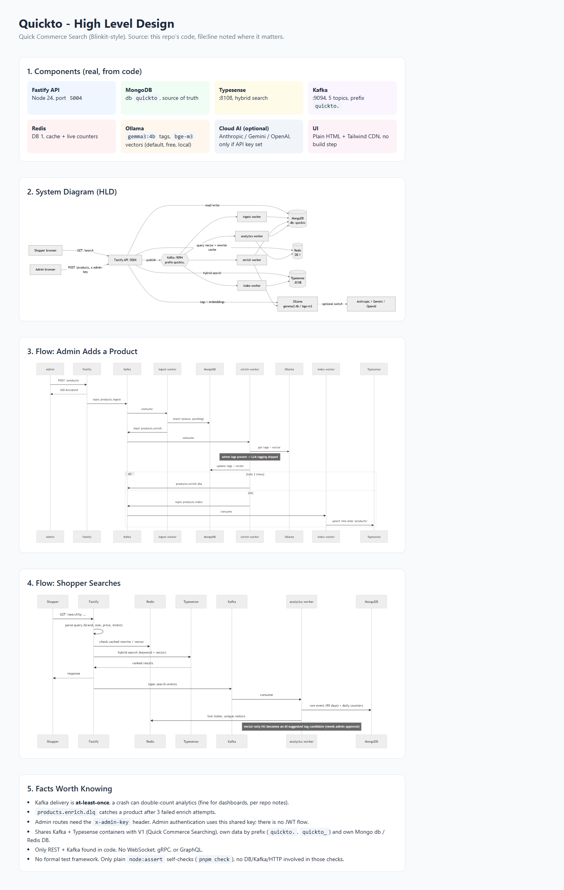

# Quickto — Multilingual Quick-Commerce Search

Quickto is a demo grocery-search application. A shopper chooses a delivery area and searches the products available at that area's dark store. Search supports English, Hindi, Hinglish, regional scripts, spelling variations, and natural-language requests across the project's 12 language groups.

> **Scope:** This project demonstrates grocery catalog search, product ingestion, AI-assisted tagging, and search analytics. The cart is a UI demo; it does not place real orders, process payments, or dispatch deliveries.


_The screenshot shows the initial shop screen and its delivery-area picker. Product results and admin metrics require the backend services and seeded data described below._

## What problem does Quickto solve?

Grocery searches are not always clean product names. A shopper might type `doodh`, `paal`, `दूध`, or `milk`, or describe a need as `mujhe chai peeni hai`. Quickto combines curated language data, query parsing, and vector search to find relevant products. It can also parse details such as brand, pack size, and price from a query.

The application also demonstrates the backend work behind a catalog search:

- Admins can add and manage products without waiting for AI enrichment to finish.
- Background workers tag products, create embeddings, and update the search index.
- Search and product-interaction events feed an analytics dashboard.
- A pincode selects the relevant city and dark store, so results can be restricted to that store's catalog.

Example searches:

| Shopper types | Quickto understands |
|---|---|
| `doodh`, `paal`, `दूध`, or `milk` | These terms can find milk products |
| `mujhe chai peeni hai` | A tea-drinking intent that can match tea-related products |
| `amul doodh 1 litre 60 se kam` | Brand, size, and maximum-price filters |

## High-level design

The API handles interactive requests. Kafka carries work that can happen asynchronously, so a product request can be accepted before AI tagging and indexing are complete.





_This screenshot is generated from the repository's [HLD page](docs/hld.html); the page includes component, product-ingestion, and shopper-search diagrams._

### Main request and data flows

**Adding a product**

1. The admin sends a product to `POST /products`; the API validates it and queues a Kafka message.
2. The ingest worker saves the product in MongoDB with a `pending` status.
3. The enrich worker generates tags and an embedding vector, then saves them in MongoDB.
4. The index worker writes the enriched product to Typesense and marks it `indexed`.
5. After three enrichment failures, the message goes to the dead-letter topic for investigation.

**Searching**

1. The shop sends a query and optional pincode to `GET /search`.
2. Quickto parses filters and intent, then gets a vector/search results from Typesense.
3. Results are returned to the browser; a search event is published to Kafka.
4. The analytics worker updates raw-event records, daily rollups, and Redis live counters.

**AI-suggested tags**

Searches that find a product by meaning but not by keywords can create tag suggestions. The admin reviews and approves or rejects suggestions; clicks alone do not activate tags.

## Engineering challenges addressed in the codebase

These are design problems the implementation handles; they are not claims about a particular development history.

| Challenge | Approach |
|---|---|
| Shoppers use different scripts, transliterations, and typos | Curated language knowledge, query normalization, optional rewrite, and vector search |
| Queries contain several constraints or describe an intent | Query parser extracts filters; intent rules help rank results |
| Products need AI enrichment without making admin requests wait | Kafka-based asynchronous ingest, enrich, and index workers |
| AI or indexing can fail temporarily | Retries, explicit product states, and a dead-letter topic after repeated enrichment failures |
| Search vectors depend on the embedding model | Embedding-aware Typesense collections and a reindex/alias-switch workflow |
| Untrusted tags could pollute search | Tag safety checks fail closed; suggested tags require admin approval |
| Analytics events may be replayed after a crash | At-least-once processing is acceptable for dashboard counters, but can double-count a replay |
| Multiple versions share local infrastructure | Separate Mongo database, Redis DB, Kafka topic prefix, and Typesense collection prefix |

## V1 → Quickto (V2)

Quickto started as a copy of `../2.Quick Commerce Searching` (V1). This version adds a tag-safety gate, admin-approved search suggestions, a shared light/dark theme, and isolated data namespaces. V1 and Quickto may share Kafka and Typesense containers, but their application data is kept separate.

| Change | Where |
|---|---|
| Tag safety gate: an LLM judge checks every tag that is not a curated KB word (LLM tags, admin tags, approved search queries). Fails closed. No word list. | `src/ai/tagging/tag-guard.ts`, [repository safety rule](../../../rules/scoped/content-safety.md) |
| Suggested tags go live only on admin approval, never on clicks alone | `src/analytics/suggestions.ts` |
| Light / dark theme on the shop and the admin, toggle in the header | `public/assets/theme.css`, `public/assets/theme.js` |
| Own data next to V1 on the same containers: db `quickto`, Redis DB 1, Kafka prefix `quickto.`, Typesense prefix `quickto_`, port 5004 | `src/bootstrap/env.ts` |

## Stack

| Part | Technology | Why it is used |
|---|---|---|
| API/runtime | Node.js 24, TypeScript, Fastify 5 | Typed REST API for search, products, events, admin, health checks, and serving the UI |
| Data | MongoDB + Mongoose | Main store for products, tags, vector references, and analytics |
| Search | Typesense 30.2 | Fast keyword search, vector search, hybrid ranking, synonyms, and collection aliases |
| Queue | Kafka + `@confluentinc/kafka-javascript` | Decouples product ingestion/enrichment/indexing and analytics from HTTP requests |
| Cache/live data | Redis | Query vectors and rewrites, AI settings, rate limits, visitor IDs, and live dashboard values |
| Local AI | Ollama: `gemma3:4b` and `bge-m3` | Language-model tasks and multilingual embedding vectors; runs locally by default |
| Optional AI | OpenAI, Anthropic, Gemini | Alternative providers; selected with environment variables or the admin settings page |
| Frontend | HTML, CSS, browser JavaScript, Tailwind CDN | Shop and admin pages without a frontend bundler |
| Admin visuals | Chart.js, Leaflet | Analytics charts and the demand/location map |
| Validation/docs/logs | Zod, Swagger, Winston | Environment and request validation, interactive API docs, and structured server logs |
| Build/tooling | TypeScript compiler, tsup, pnpm | Type-checks and bundles the API, workers, and command-line scripts |
| Local services | Docker Compose | Starts the MongoDB replica set, Kafka, and Typesense |

## How it works

```
Admin "Add product"            POST /products -> 202
        |
        v
  products.ingest  --ingest worker-->  Mongo (status: pending)
        |
        v
  products.enrich  --enrich worker-->  tags (rules + LLM) + vector (bge-m3) -> Mongo
        |                              admin tags for the same title: LLM skipped
        v                              3 failures -> products.enrich.dlq
  products.index   --index worker--->  Typesense (alias "products")

Shopper search   GET /search -> query parser (filters) -> hybrid search -> intents re-rank
                 Hinglish rewrite runs in the background and is cached for the next time
        |
        v
  search.events  --analytics worker-->  raw events (90 days) + daily counters (stats_daily)
                                        + Redis (visitors, live) + AI suggested tags
```

### AI suggested tags

1. A search finds a product only by meaning (vector hit, no keyword hit). The pair becomes a candidate.
2. The AI checks if the pair makes sense.
3. It goes live as a tag only when the admin approves it and the query passes the tag safety gate. Clicks and distinct shoppers are shown to the admin, they never activate a tag.

## Run Quickto locally

### Requirements

- Node.js 24 and pnpm 11 (the project uses TypeScript and `tsup`).
- Docker Desktop for MongoDB, Kafka, and Typesense.
- Redis, either installed locally or run as a Docker container.
- Ollama for the default local AI setup. The project can use configured cloud AI providers instead.

The commands below use Windows PowerShell. Run them from the Quickto project directory:

```powershell
Set-Location 'system-design-journey\season-1\5.Stats\Quickto'
Copy-Item .env.example .env
pnpm install
```

If `.env` already exists, do not overwrite it; inspect and update its settings instead. `.env.example` contains local development defaults and no provider API keys.

### Start the supporting services

```powershell
pnpm mongo:up
pnpm kafka:up
pnpm typesense:up
```

`pnpm mongo:up` starts this project's three-node MongoDB replica set. Its preflight check stops before Docker startup if one of the MongoDB ports (`27017`–`27019`) is already in use; it does not stop another process for you.

Quickto does not include a Redis Compose file. If Redis is not installed and running locally, start it once with Docker:

```powershell
docker run --name quickto-redis -p 6379:6379 -d redis:7-alpine
```

On later runs, use `docker start quickto-redis` if that container already exists. The default `.env` uses Redis database `1`.

Install Ollama, start its local service, and download the default models:

```powershell
ollama pull gemma3:4b
ollama pull bge-m3
```

`gemma3:4b` is used for language-model tasks such as tags and rewrites; `bge-m3` produces search embeddings. These models require disk space and memory. To use OpenAI, Anthropic, or Gemini instead, configure the provider and model variables in `.env` and provide the corresponding API key.

### Check, seed, and index the catalog

```powershell
pnpm check
pnpm ai:check
pnpm seed:products -- --count=500 --yes
pnpm reindex -- --yes
```

- `pnpm check` runs the project's local self-checks; it does not need MongoDB, Kafka, or an AI service.
- `pnpm ai:check` checks the configured language and embedding models.
- `pnpm seed:products` writes demo products and vectors to MongoDB. Without `--count`, its default is **200,000 products** and it asks for confirmation. Start with a smaller count while learning the project.
- `pnpm reindex` builds a Typesense collection from MongoDB data and switches the `products` alias. It changes the search index.

The seed scripts only write to databases whose names start with `quickto`. The explicit `--allow-db=<name>` option bypasses that protection; use it only when you have checked the target database. Changing the MongoDB, Kafka, or Typesense namespace does not migrate data from the previous namespace.

### Start the API and workers

The API and workers are separate processes. On Windows, build once and run each process in its own PowerShell window:

**Terminal 1 — from the Quickto project directory**

```powershell
pnpm build
node dist\workers.js
```

**Terminal 2 — from the same directory**

```powershell
node dist\server.js
```

Then open:

| URL | What you will see |
|---|---|
| `http://localhost:5004/` | Shopper search |
| `http://localhost:5004/admin` | Admin dashboard |
| `http://localhost:5004/api-docs` | Swagger API documentation |
| `http://localhost:5004/health` | Liveness check |
| `http://localhost:5004/ready` | MongoDB, Typesense, Kafka, and Redis readiness |

In local development, if `ADMIN_KEY` is empty, the API uses `dev-admin-key`. Set a real `ADMIN_KEY` before exposing the app outside your machine. The `pnpm dev` script uses Unix shell process-control syntax; the two-terminal commands above avoid that shell dependency on Windows.

### Optional demo traffic and search evaluation

```powershell
pnpm seed:traffic -- --days=30 --searches=10000 --yes
pnpm eval:search
```

Traffic seeding publishes simulated shopper events to Kafka; keep the analytics worker running. The search evaluation reports results for the project's fixed query set and does not write data.

`pnpm workers` can run workers without the API. Set `WORKER_ROLES=enrich` to run a specific worker role. See `package.json` for the other service, status, and logging commands.

## Pages

| URL | Page |
|---|---|
| `/` | Shop: location picker, search with suggestions, filter chips, cart |
| `/admin` | Overview: KPIs, trend, script split, live searches, top and zero-result searches |
| `/admin/searches` | Every search, sortable; click one for its detail (products clicked, cities, similar searches) |
| `/admin/products` | Product performance; product detail with tags editor |
| `/admin/products/new` | Add a product: instant rule tags, "Generate with AI", edit tags, follow it through the pipeline |
| `/admin/locations` | Demand map, cities, "where to open the next store", "what to stock" |
| `/admin/suggestions` | AI suggested tags: approve or reject |
| `/admin/settings` | Admin key, switch the LLM without a restart, search index status |
| `/api-docs` | Swagger |

Every admin page has a date filter (today, yesterday, 7 days, 30 days, this month, custom) and a city filter.

The admin key goes in the `x-admin-key` header. With `ADMIN_KEY` empty in dev, the key is `dev-admin-key`. Production needs a real one.

## API

| Route | Notes |
|---|---|
| `GET /search?q=&pincode=&page=&ignore=` | Hybrid search, rate limited. `ignore=brand,price,size` drops a parsed filter |
| `GET /search/suggest?q=` | Prefix search for the dropdown, sends no event |
| `GET /search/popular?pincode=` | Empty search box: trending categories in the city, popular products in the store. Other shoppers' searches are never shown |
| `POST /events` | Shop click and add events, rate limited |
| `GET /locations/cities`, `/search?q=`, `/resolve?pincode=`, `/stores` | Static location data |
| `GET /products`, `/products/:id`, `/products/categories` | Catalog reads |
| `POST /products`, `PUT /products/:id`, `DELETE /products/:id` | Admin. Queued on Kafka, answers 202 |
| `POST /products/preview-tags` | Admin. `mode: rules` (instant) or `full` (rules + LLM). Saves nothing |
| `GET /analytics/*` | Admin. overview, searches, products, locations, live, suggestions |
| `GET/PUT/DELETE /settings/ai` | Admin. LLM switch, stored in Redis |
| `GET /health`, `GET /ready` | Liveness, and Mongo / Typesense / Kafka / Redis state |

## Switching AI providers

Each provider lives in `src/ai/providers/<name>/` with its own config, types and provider file.

| How | What changes |
|---|---|
| `.env`: `AI_LLM_PROVIDER`, `AI_LLM_MODEL` | The default LLM |
| `.env`: `AI_LLM_FALLBACK`, `AI_LLM_FALLBACK_MODEL` | Used when the main LLM fails |
| Settings page | LLM for the API and all workers within 10 s, no restart |
| `.env`: `AI_EMBED_PROVIDER`, `AI_EMBED_MODEL`, `AI_EMBED_DIMS` + `pnpm reindex` | Embeddings. Old and new vectors cannot mix |

Keys: `OPENAI_API_KEY`, `ANTHROPIC_API_KEY`, `GEMINI_API_KEY`. A provider without a key is greyed out in Settings.

## Environment

Read and checked by `src/bootstrap/env.ts` and `src/ai/ai.config.ts`.

| Group | Variables |
|---|---|
| Server | `PORT` (5004), `NODE_ENV`, `LOG_LEVEL`, `ADMIN_KEY` |
| Mongo | `MONGO_URI` (`mongodb://127.0.0.1:27017/quickto`), `MONGO_MODE`, `MONGO_MIN_POOL`, `MONGO_MAX_POOL`, `MONGO_SELECT_TIMEOUT_MS`, `MONGO_CIRCUIT_FAILS`, `MONGO_CIRCUIT_MS` |
| Redis | `REDIS_URL` (`redis://127.0.0.1:6379/1`, V1 uses DB 0 with the same key names) |
| Kafka | `KAFKA_BROKERS` (`127.0.0.1:9094`), `KAFKA_CLIENT_ID` (`quickto`), `KAFKA_TOPIC_PREFIX` (`quickto.`) |
| Typesense | `TYPESENSE_URL`, `TYPESENSE_API_KEY`, `TYPESENSE_COLLECTION_PREFIX` (`quickto_`) |
| AI | `AI_LLM_*`, `AI_EMBED_*`, `AI_TIMEOUT_MS`, `OLLAMA_URL`, `OLLAMA_KEEP_ALIVE`, `OLLAMA_NUM_CTX`, `*_API_KEY`, `*_BASE_URL`, `ANTHROPIC_VERSION` |
| Search | `SEARCH_REWRITE`, `RATE_LIMIT_SEARCH_PER_MIN`, `RATE_LIMIT_EVENTS_PER_MIN` |

`NODE_ENV=test` loads `.env.test` instead of `.env`. The checked-in test environment is separate from the local example; verify its database, Redis, and Kafka targets before running any test-mode worker or seed command. `pnpm check` does not use external services.

## Folder structure

```text
Quickto/
├── src/                         Backend TypeScript
│   ├── ai/                      AI providers, tag rules, tag safety, query rewrite
│   │   ├── providers/           Ollama, OpenAI, Anthropic, Gemini
│   │   ├── tagging/             Knowledge bases, rules, schemas, safety guard
│   │   └── rewrite/             Search rewrite prompts and logic
│   ├── analytics/               Search events, rollups, dashboard queries, suggestions
│   ├── bootstrap/               Env, MongoDB, Redis, Kafka, Typesense, shutdown
│   ├── catalog/                 Aisle JSON data and embedding text helpers
│   ├── features/
│   │   ├── products/            Product model, validation, controller, routes
│   │   └── settings/            AI settings routes
│   ├── locations/               City, pincode, and dark-store lookup
│   ├── search/                  Query parsing, embeddings, Typesense, reindex, evaluation
│   ├── seed/                    Product generator and demo data scripts
│   ├── shared/                  Errors, auth, pagination, rate limits, validation
│   ├── workers/                 Ingest, enrich, index, analytics consumers
│   ├── app.ts                   Fastify app, routes, and static pages
│   ├── server.ts                HTTP server entry point
│   └── workers.ts               Kafka workers entry point
├── public/                      Shop, admin HTML, CSS, and browser JavaScript
│   └── assets/admin/            Admin dashboard views and helpers
├── infra/                       Docker Compose for MongoDB, Kafka, Typesense
├── scripts/                     Mongo checks and benchmark utilities
├── docs/                        HLD and add-product LLD
│   └── screenshots/             README UI screenshots
├── .env.example                 Local development environment template
├── package.json                 Commands and dependencies
└── README.md                    Setup, architecture, and usage
```

### Where to start reading the code

- Product HTTP flow: `src/features/products/products.router.ts` → `products.controller.ts`.
- Product data shape: `src/features/products/products.model.ts`.
- Background pipeline: `src/workers/ingest.worker.ts` → `enrich.worker.ts` → `index.worker.ts`.
- Search request flow: `src/search/search.router.ts` → `search.controller.ts` → `search.service.ts`.
- Analytics: `src/analytics/events.router.ts` and `src/workers/analytics.worker.ts`.
- Infrastructure and environment defaults: `src/bootstrap/` and `.env.example`.
- Visual system diagram: [`docs/hld.html`](docs/hld.html).
- Product-add implementation diagram: [`docs/lld-add-product.html`](docs/lld-add-product.html).

## Kafka topics and groups

| Topic | Group | Worker |
|---|---|---|
| `quickto.products.ingest` | `quickto.qc-ingest` | Writes Mongo, routes to enrich or index |
| `quickto.products.enrich` | `quickto.qc-enrich` | Tags + vector |
| `quickto.products.enrich.dlq` | none | Products that failed 3 times |
| `quickto.products.index` | `quickto.qc-index` | Typesense upsert / delete |
| `quickto.search.events` | `quickto.qc-analytics` | Counters, visitors, suggested tags |

The names above show the default `KAFKA_TOPIC_PREFIX=quickto.`. Auto topic creation is off; the app creates its topics on startup.

## Notes

- Analytics is at-least-once. A batch read again after a crash can count twice. Fine for dashboards.
- Days are India time (IST). A search at 23:30 belongs to that day.
- Seeded products share the vector of their base item, so 2 lakh products need about 150 embeddings.
